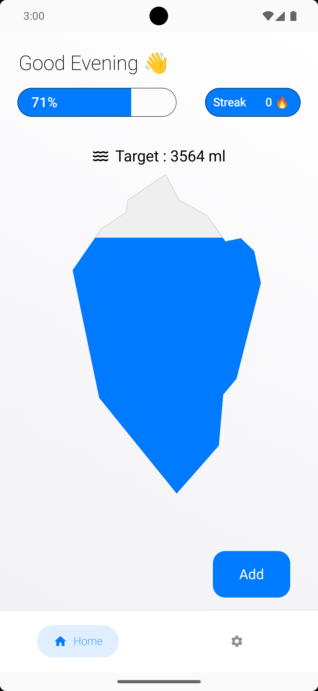
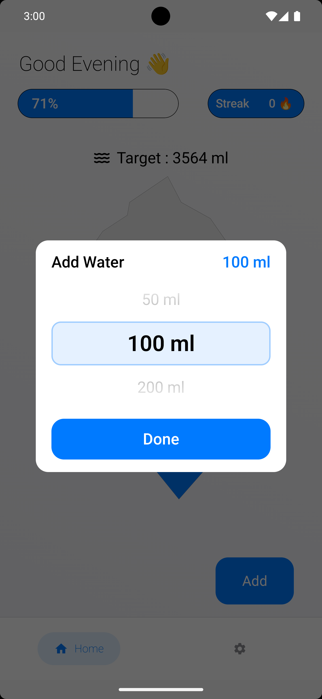
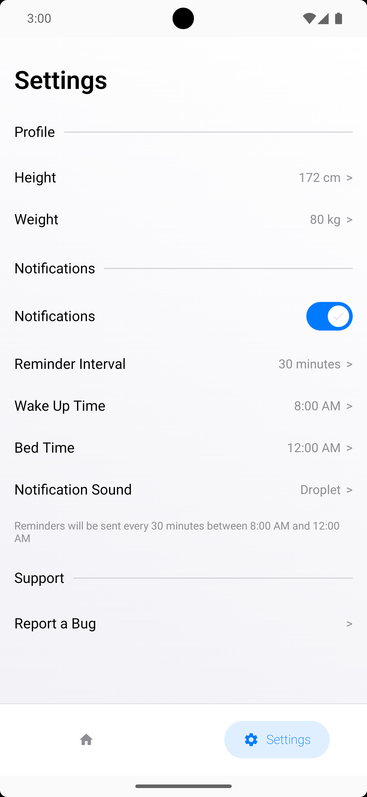
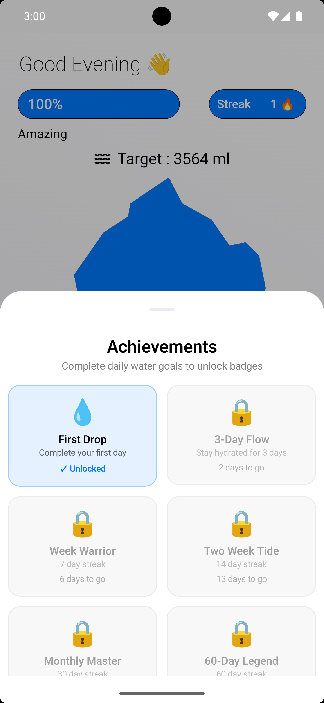
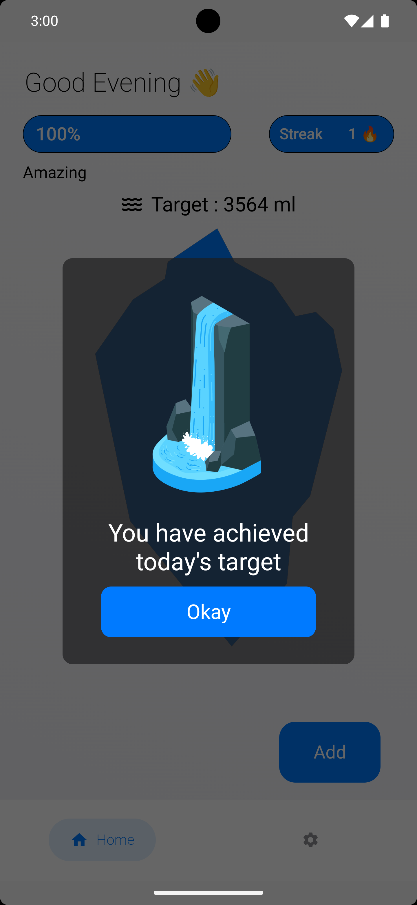
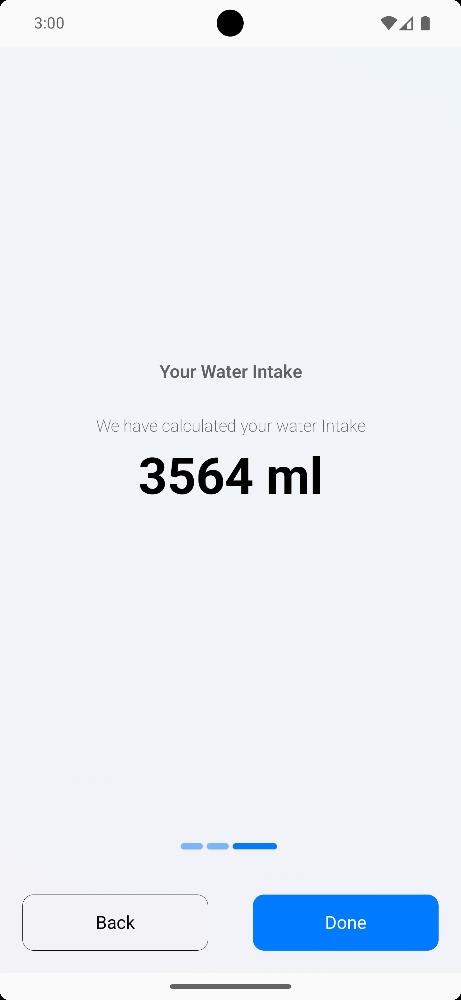

<h1 align="center">Droply</h1>

<p align="center"><b>Water Tracker &amp; Drink Water Reminder for Android and iOS</b></p>

<p align="center">
  <a href="https://play.google.com/store/apps/details?id=com.falcon.hydrohabit"></a>
</p>

<p align="center">
  <a href="https://github.com/labmember003/HydroHabit/releases/latest"></a>
  <a href="https://github.com/labmember003/HydroHabit/actions/workflows/release.yml"></a>
  <a href="LICENSE"></a>
</p>

Welcome to Droply, an open-source water-tracking app developed using Jetpack Compose and Kotlin. Droply is a simple water-tracking app that helps users develop a habit of tracking their water. It also has habit charts and goals that help them remain healthy and inculcate good habits in their lives.

## Screenshots

<p align="center">
  
  
  
</p>
<p align="center">
  
  
  
</p>

## Download

- **Android:** [Google Play](https://play.google.com/store/apps/details?id=com.falcon.hydrohabit), or the APK attached to the [latest GitHub release](https://github.com/labmember003/HydroHabit/releases/latest).
- **iOS:** each [GitHub release](https://github.com/labmember003/HydroHabit/releases/latest) includes an unsigned `.ipa`. Sideload it with [AltStore](https://altstore.io) or [Sideloadly](https://sideloadly.io), which sign it with your own Apple ID.

### Droply Features

- **Daily Water Intake Tracking:** Log your daily water consumption easily.
- **Customizable Goals:** Set personal water intake goals based on your needs.
- **Progress Ring & Streaks:** Watch an animated water level rise toward your daily goal, and build a streak of successful days.
- **Achievement Badges:** Unlock 8 milestones, from First Drop to 365-Day Champion.
- **Reminder Notifications:** Receive reminders to stay hydrated throughout the day.
- **Dark Mode Support:** Seamlessly switch between light and dark modes for comfortable usage.
- **Rewards:** Animation Reward for drinking water
- **BMI:** Settings to Track your BMI

## Releasing

Pushing a version tag runs [`.github/workflows/release.yml`](.github/workflows/release.yml), which builds the Android APK and the iOS IPA and attaches both to a GitHub Release:

```bash
git tag v1.0.0
git push origin v1.0.0
```

Tags containing a hyphen (for example `v1.1.0-beta1`) are published as pre-releases. To build both files without publishing a release, open **Actions → Release → Run workflow**; the files are attached to the run as artifacts.

**Android signing:** add these repository secrets (Settings → Secrets and variables → Actions) so the APK is signed with your own key. Without them, CI signs it with a temporary key.

| Secret | Value |
|---|---|
| `ANDROID_KEYSTORE_BASE64` | Output of `base64 -i your-release.jks` |
| `ANDROID_KEYSTORE_PASSWORD` | Keystore password |
| `ANDROID_KEY_ALIAS` | Key alias |
| `ANDROID_KEY_PASSWORD` | Key password (optional if it matches the keystore password) |

---

## Future Implementation: The Hydration Calendar

> **Status:** Planned — not yet built. The app currently ships with the progress ring, streaks, and achievement badges only; there is **no** calendar or history view today. This section is the design spec for an ambitious history-and-insights feature planned for a future release.

The Hydration Calendar turns Droply from a "did I drink today?" app into a "how is my hydration habit trending over months?" app. It is the home for all historical data, insights, and long-term motivation.

### 1. Monthly Heatmap (the centerpiece)

A GitHub-contributions-style grid for water, one cell per day.

- **Color intensity by goal completion:** empty (no intake), faint blue (1–49% of goal), mid blue (50–99%), full `waterColor` (100%+), and a subtle glow/ring for overachiever days (150%+).
- **Today marker:** a distinct border on the current day so it never gets lost.
- **Streak lines:** consecutive completed days are visually connected (a light underline or linked cells) so streaks read as unbroken chains at a glance.
- **Swipe between months** with smooth horizontal paging; month + year header updates as you scroll.
- **Tap any day** to open a Day Detail sheet (see §4).

### 2. Summary Header (per month)

A compact stats band above the grid:

- **Days hydrated:** `18 / 31` with a thin progress bar.
- **Average intake:** e.g. `2,140 ml/day` for the month.
- **Best streak** this month and **current active streak**.
- **Goal-hit rate:** percentage of days the goal was met.
- Unit-aware (ml / oz) and respects the user's kg/lb preference elsewhere.

### 3. Trends & Graphs

A toggleable line/bar chart under the heatmap:

- **Time ranges:** Week / Month / 3-Month / Year toggle.
- **Line chart of daily intake** with the goal drawn as a dashed reference line, so shortfalls and surpluses are obvious.
- **Rolling 7-day average** overlay to smooth out noisy days.
- **Weekday breakdown:** a bar chart of average intake per weekday (surfaces patterns like "weekends I forget to drink").
- **Best time of day:** histogram of when logs happen, to help tune reminder windows.

### 4. Day Detail Sheet

Tap a day to see:

- Total intake vs. goal for that day (ring + number).
- A timeline of every individual log (time + amount) for that day.
- **Backfill / edit:** add or correct a forgotten log for past days (with a sensible cap, e.g. last 7 days, to keep streaks honest).
- Notes: an optional one-line note per day ("gym day", "sick", "traveling").

### 5. Milestones & Annotations

- **Badge markers** pinned onto the calendar on the day each achievement was unlocked.
- **Personal-best flags** (highest single-day intake, longest streak start/end).
- **Goal-change markers** so a jump in the trend line is explained ("goal raised to 3,000 ml here").

### 6. Insights (auto-generated, friendly)

Short, non-preachy cards derived from the data:

- "You hit your goal 5 days in a row — your best this month!"
- "Tuesdays are your driest day. Want an extra reminder?"
- "You're averaging 300 ml more than last month. Nice."

### 7. Export & Share

- **Export CSV / JSON** of the full history (on-device, no account) for users who want their own records.
- **Share a month card:** render the heatmap + summary as an image to share a streak — great for organic growth.

### 8. Design & Technical Notes

- **On-device only:** all history stays local (consistent with the app's privacy stance — health inputs never leave the device). No backend required.
- **KMP-shared:** implement the calendar as shared Compose Multiplatform UI in `commonMain`, with data from the existing local store; no platform-specific screens needed.
- **Accessibility:** heatmap cells need text/content descriptions (color alone can't encode completion) and must adapt to light/dark mode.
- **Performance:** virtualize the month grid and lazy-load older months so a year+ of history scrolls smoothly.
- **Navigation:** add a third tab (`Calendar`) to `MainScreen` alongside Home and Settings.